# 마음씬 — 씬을 조립해 내 안의 무대를 짓는다 (ver2)

> - **2026-10-13 · ver2.** [마음무대_씬무대_유저시나리오.md](마음무대_씬무대_유저시나리오.md)(ver1)를 다시 정의한 판.
> - ver1은 「컷!」 씬 무대 하나를 중심에 두고 깊은 무대를 옆문으로 뒀다. ver2는 **씬 하나를 기본 단위**로 두고, 그 씬을 만드는 **두 트랙**과 씬을 이어 붙이는 **조립**, 고친 자리를 남기는 **기록**, 그 기록에서 나를 보는 **성찰**까지 한 줄로 잇는다.
> - 짝 문서: [마음무대_씬무대_최종.md](마음무대_씬무대_최종.md) (씬 규칙 원천) · [마음무대_디렉터_개입패턴.md](마음무대_디렉터_개입패턴.md) (사이코드라마 기법) · [마음무대_열린무대_흐름표.md](마음무대_열린무대_흐름표.md) (막 구조) · [마음무대_물어보살_접수_시나리오.md](마음무대_물어보살_접수_시나리오.md) (접수·선택 바꾸기)
> - 그대로 이어받는 것: 맛(🥛→🔥) × 반(🐣→🦅) 두 축, 대다수의 순한 맛이 기본 무대(ver1 6부) · 디렉터 톤(진실하게 말해 달라는 부탁, 친구 같은 쉬운 말, 「극단적으로 / 던져 봐」 안 씀).

---

## 0. 한 줄

**「씬 하나씩 모아서, 내 안의 무대를 짓는다.」**

| 묻는 것 | 답 |
| --- | --- |
| 앱 이름 | **마음씬 (MindScene)** — 후보와 이유는 §1 |
| 기본 단위 | **씬 하나.** 상황극도, 내 이야기도 전부 같은 모양의 씬 조각이 된다 — §2 |
| 씬을 만드는 길 | 두 트랙 — 🎞 **상황극 무대**(고전·영화의 상황을 내 자리로) · 🪞 **내 무대**(사이코드라마 진행자와 내 장면을 직접) — §3·§4 |
| 둘은 어떻게 이어지나 | 다리 셋 — 「이거 내 얘긴데」 · 「이 장면, 상황극으로」 · 「닮은 고전」 — §5 |
| 완성은 | 씬 조각을 이어 붙여 **내 무대 한 편** — 단막 · 연속극 — §6 |
| 고치면 | 덮어쓰지 않는다. **고친 자리가 판본으로 남는다** — §7 |
| 결국 남는 것 | 고친 기록과 내가 쓴 마지막 컷에서 보이는 **「나 노트」** — §8 |

## 0-1. 전체 흐름도 — 사용자가 걷는 길

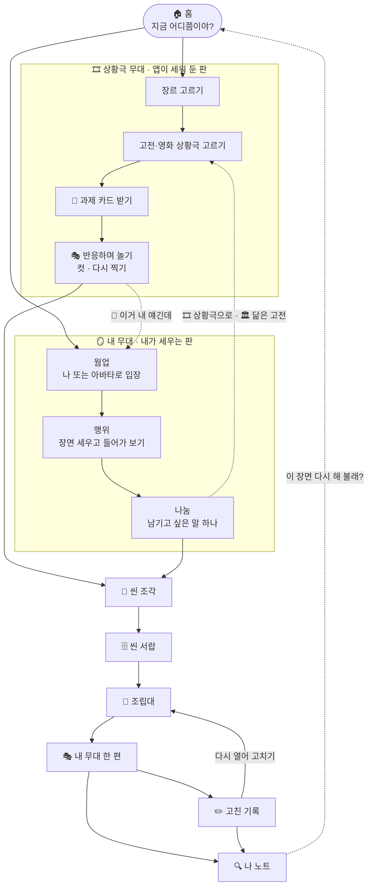

## 0-2. 단계도 — 여섯 걸음

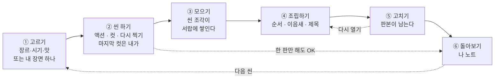

| 걸음 | 사용자가 하는 것 | 화면 | 걸리는 시간 |
| :---: | --- | --- | :---: |
| ① 고르기 | 장르 칩 하나 탭 · 또는 「장면 하나만 세워 볼래?」 | 홈 · 장르 서랍 | 10초 |
| ② 씬 하기 | 말하고, 컷하고, 다시 해 보고, 마지막 한 줄 쓰기 | 상황 카드 · 액션 · PD · 작가실/커튼콜 | 3~10분 |
| ③ 모으기 | 저장 버튼 없음 — 끝나면 자동으로 서랍에 | 씬 서랍 | 0초 |
| ④ 조립하기 | 조각 2~5개를 끌어다 놓고 사이에 한 줄 | 조립대 | 5분 |
| ⑤ 고치기 | 대사·마지막 컷·순서 바꾸기 · 「왜?」는 선택 | 씬 서랍 · 조립대 · 고친 기록 | 1분~ |
| ⑥ 돌아보기 | 나 노트 읽고 `맞아` `아닌데` · 한 줄 덧붙이기 | 나 노트 | 2분 |

## 0-3. 화면 지도 — 어느 화면에서 어디로

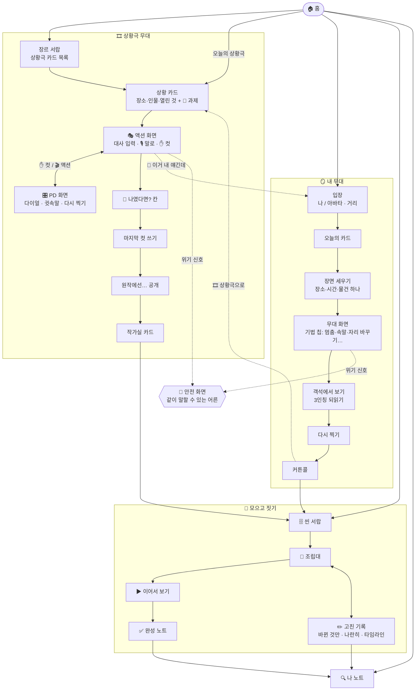

---

# 1부 — 앱 이름

## 1. 「나만의 내면 무대 만들기」를 담는 이름

| 후보 | 읽는 법 | 왜 | 걸리는 것 |
| --- | --- | --- | --- |
| **마음씬 (MindScene)** ⭐ | 마음씬 | 마음무대에서 한 글자만 바꿨다 — **무대 → 씬.** 「마음 속 장면」이자 「장면을 모아 짓는 마음」. 씬이 기본 단위라는 구조가 이름에 그대로 들어간다 | 「씬」이 중1에겐 낯설 수 있음 → 첫 화면 한 줄: 「씬 = 장면 하나」 |
| 속무대 | 속무대 | 「속마음」의 「속」 + 무대. 겉으로 안 보이는 데 세우는 무대. 짧고 한국어다움 | 「속」이 「속이다」로 읽힐 여지 · 영어 표기가 어색 |
| 씬북 (Scene Book) | 씬북 | 씬을 모아 한 권 = 조립과 기록이 이름에 다 있다 | 「내면」 느낌이 약하다. 다이어리 앱처럼 보임 |
| 나의 무대 | 나의 무대 | 가장 쉬운 말. 13세도 바로 안다 | 흔해서 검색·상표가 어렵다 |
| 인사이드 씬 | 인사이드 씬 | 내면 + 장면이 바로 읽힌다 | 유명 애니메이션 제목과 겹쳐 보임 → 피함 |

**추천 — 「마음씬」**
- 서비스 전체 이름. 기존 「마음무대」는 🪞 **내 무대** 트랙의 이름으로 남긴다(엔진·문서 이름 그대로 이어짐).
- 앱 안의 동작 언어는 ver1을 이어받는다 — **컷 · 테이크 · 다시 찍기 · 마지막 컷.** 「컷!」은 앱 이름이 아니라 **버튼**이 된다.
- 태그라인: **「씬 하나씩 모아서, 내 안의 무대를 짓는다.」**
- 짧은 판: **「내 안의 무대, 한 씬씩.」**
- 앱 스토어 표기: 「마음씬 — 내 안의 무대를 짓는 장면 놀이」

> 이름을 사용자에게 한 줄로: **「씬은 장면 하나야. 모으면 네 무대가 돼.」**

**앱 안의 이름들**

| 자리 | 이름 | 한 줄 |
| --- | --- | --- |
| 🎞 트랙 A | **상황극 무대** | 고전·영화에 있던 상황에 내가 들어간다 |
| 🪞 트랙 B | **내 무대** | 내 장면을 직접 세운다. 진행자가 같이 있다 |
| 🧩 씬 하나 | **씬 조각** | 두 트랙에서 나온 장면 하나 |
| 🗄 보관함 | **씬 서랍** | 씬 조각과 그 테이크들 |
| 📖 조립대 | **조립대** | 씬 조각을 순서대로 놓고 이음새를 쓰는 곳 |
| 🎭 완성본 | **내 무대 한 편** | 단막(3~5씬) 또는 연속극(5편) |
| ✏️ 기록 | **고친 기록** | 다시 찍고, 고치고, 바꾼 자리 |
| 🔍 성찰 | **나 노트** | 내가 쓴 말과 고친 자리에서 보이는 것 |

---

# 2부 — 전체 구조: 씬이 기본 단위

## 2. 씬 조각 — 두 트랙이 같은 모양을 만든다

상황극에서 나왔든 내 이야기에서 나왔든, 저장되는 건 **같은 모양의 씬 하나**다. 그래서 섞어서 이어 붙일 수 있고, 같은 방식으로 고치고, 같은 방식으로 돌아본다.

```
🧩 씬 조각
S#.  장소 / 시간 / 빛·소리 하나
[출처]      🎞 상황극(원형: 고전·영화 유형)  |  🪞 내 무대(내 장면)
[인물]      🎭 나(또는 가명 주인공) · 상대 1~3 (원하는 것 · 숨기는 것 · 다이얼)
[고정 사실]  3개 안팎
[열린 것]    3개 안팎
[결정적 자리] 🌟 여기서 내가 한 줄을 넣는다
[마지막 컷]  대사 한 줄 + 지문 한 줄 — 내가 쓴다
[테이크]     1, 2, 3… (지우지 않음)
[맛 · 반]    🥛~🔥 · 🐣~🦅
```

| | 🎞 상황극 무대 | 🪞 내 무대 |
| --- | --- | --- |
| 씬이 어디서 오나 | 고전·영화에 이미 있던 **상황** | 내가 겪은 **장면** |
| 판은 누가 세우나 | 앱이 세워 둔다(구조화) | 내가 세운다. 진행자가 돕는다 |
| 나는 누구 | 가명 주인공(중학생 자리로 옮긴 인물) | 나 — 또는 나를 대신 세운 아바타 |
| 재미의 결 | **반응하며 노는 것** — 상대가 받아치면 나도 받아친다 | **안을 보는 것** — 멈추고, 자리 바꾸고, 객석에서 본다 |
| 진행 | 연기 실습처럼 과제가 있다(목표 · 장애물 · 시간) | 사이코드라마처럼 단계가 있다(웜업 → 행위 → 나눔) |
| 끝에 | 원작 공개 + 작가실 | 거울 + 커튼콜 |
| 남는 것 | 🧩 씬 조각 | 🧩 씬 조각 |

---

# 3부 — 🎞 트랙 A · 상황극 무대: 고전과 영화에서 가져온 상황

## 3. 원칙 — 무엇을 가져오고 무엇을 안 가져오나

연기 수업에서 하는 상황극처럼, **이미 수백 번 검증된 상황**을 가져와 내 자리로 옮긴다. 대사는 안 가져온다. 상황만.

| | 🏛 고전 (희곡·소설·설화) | 🎬 영화 |
| --- | --- | --- |
| 가져오는 것 | 상황 · 인물 관계 · 명대사가 있던 **자리** | 상황의 **뼈대**(유형) — 「한 방에 갇힌 열두 명이 한 명을 설득」 같은 구조 |
| 안 가져오는 것 | 명대사를 먼저 보여주지 않는다(컷 뒤에 공개) | 대사 · 인물 이름 · 고유 설정 · 장면 묘사 · **앱 화면에 작품 제목** |
| 공개 | 컷 뒤 「원작에선」 — 원어 짧게 + 우리가 새로 쓴 풀이 | 「이런 상황, 영화에서 많이 봤지?」까지만. 작품 이름은 안 씀 |
| 근거 | 저작권 만료 작품 위주 · 번역은 직접 새로 씀 | 상황 유형은 장르의 공용 문법. 특정 작품을 떠올리게 하는 고유 요소는 빼는 체크리스트 (최종.md §19-2) |

**번안 규칙 — 「중학생 자리로 옮기기」**
1. 장소는 교실 · 급식실 · 단톡 · 식탁 · 학원 셔틀 · 편의점 같은 **이번 주의 장소**로.
2. 걸린 것의 크기는 맛을 따른다 — 🥛에선 원작의 칼싸움이 「반티 투표」가 된다.
3. 원작 인물의 **원하는 것 · 숨기는 것**은 그대로 옮긴다. 그게 상황극의 힘이다.
4. 상대 인물은 대사 0줄, 애드립만. 내 말에 **반응하며** 판을 같이 끌고 간다.

## 4. 연기 실습식 과제 카드

연기 수업의 상황극은 「무슨 말을 해라」가 아니라 **「이걸 원해. 근데 이게 막아. 시간은 이만큼」**을 준다. 그래서 노는 사람마다 다른 장면이 나온다.

```
🎯 과제 카드
원하는 것    교실 문 닫히기 전에 하윤이 「같이 가자」를 받아내기
막는 것      하윤은 오늘 다른 애랑 약속이 있다 (너는 모른다)
비밀         너는 어제 그 약속 얘기를 단톡에서 봤다
시간         ⏱ 쉬는 시간 3분
몸 하나      가방끈을 계속 만진다
```

| 과제 유형 | 연기 실습에서의 이름 | 원형 예 |
| --- | --- | --- |
| 🗣 설득 | 마음 바꾸기 | 한 명이 열한 명을 / 열한 명이 한 명을 |
| 🙏 부탁 | 들어주게 하기 | 대신 써 달라 · 숨겨 달라 |
| ✋ 거절 | 상처 안 주고 「아니」 | 식탁에서 처음 「아니」 |
| 🤐 비밀 지키기 | 들키지 않고 버티기 | 가면 쓴 사람 · 대신 쓴 편지 |
| 💌 고백 · 속마음 | 처음 말하기 | 발코니 · 창가 |
| 🙇 사과 | 늦은 사과 | 떠났던 동생이 돌아옴 |
| 📢 소식 전하기 | 나쁜 소식 첫 마디 | 전령 · 편지 |
| 🔍 알아내기 | 숨긴 걸 캐기 | 사라진 물건 · 마지막으로 본 사람 |
| ⏳ 시간 안에 | 마감 전에 결정 | 기차 출발 3분 전 · 마감 1시간 전 |
| 🔁 다시 그날 | 같은 하루를 다르게 | 반복되는 하루 |

## 5. 장르 → 상황극 서랍

장르를 먼저 고르면 그 장르의 상황극이 서랍처럼 열린다. **위 칸이 🥛 순한 번안**, 진한 번안은 메뉴판 아래쪽(ver1 6부 맛 사다리 그대로).

| 장르 | 원형 | 출처 | 원형의 상황 (뼈대) | 🥛 중학생 자리로 | 🎯 과제 |
| --- | --- | :---: | --- | --- | --- |
| 💘 로맨스 | 발코니 고백 | 🏛 로미오와 줄리엣 | 원수 집안 둘이 밤에 창가에서 마음을 확인 | 맞은편 동에 사는 애, 학원 앞 30분 기다림 | 💌 처음 말하기 · 🌟 명대사 자리 |
| 💘 로맨스 | 대신 쓰는 편지 | 🏛 시라노 | 말 잘하는 사람이 다른 사람 대신 연애편지를 써 줌 | 친구 대신 DM 써 주기 — 근데 나도 그 애가 좋다 | 🤐 비밀 지키기 |
| 💘 로맨스 | 기차 출발 전 | 🎬 유형 | 떠나는 사람과 남는 사람, 플랫폼 3분 | 전학 가는 날 학원 셔틀 정류장 | ⏳ 시간 안에 |
| 🏠 가족극 | 세 딸의 대답 | 🏛 리어 왕 | 아버지가 「누가 날 제일 사랑하냐」고 묻는다 | 명절, 할머니가 「누가 제일 자주 오냐」 | ✋ 거절 · 🗣 설득 |
| 🏠 가족극 | 식탁에서 처음 「아니」 | 🏛 인형의 집 | 늘 맞춰 주던 사람이 처음으로 다른 말을 함 | 학원 하나 더 — 처음으로 「싫어」 | ✋ 거절 |
| 🏠 가족극 | 돌아온 동생 | 🏛 돌아온 탕자(성경 비유) | 떠났던 자식이 돌아오고 남아 있던 형이 서운함 | 가출 아닌 「반나절 연락 두절」 뒤 동생이 귀가 | 🙇 사과 · 받기 |
| 🔍 추리 | 사라진 물건 | 🎬 유형 | 한 공간 · 용의자 몇 · 아무도 안 나감 | 사라진 학급비(ver1 §3) | 🔍 알아내기 |
| 🔍 추리 | 마지막으로 본 사람 | 🏛 셜록 홈즈 단편들 | 작은 흔적으로 거짓말을 알아챔 | 체육복이 바뀌어 있다 | 🔍 알아내기 · 🤐 |
| ⚖️ 법정·토론 | 한 방의 열두 명 | 🎬 유형 | 모두 한쪽인데 한 명만 「잠깐만」 | 반티 투표 28:1, 내가 그 1 | 🗣 설득 |
| ⚖️ 법정·토론 | 살 1파운드 | 🏛 베니스의 상인 | 계약의 글자를 끝까지 따짐 | 「내기에서 진 사람 매점」 — 말 그대로 지키라는 친구 | 🗣 설득 · 🔍 |
| 😂 코미디 | 뒤바뀐 사람 | 🏛 실수 연발 · 왕자와 거지 | 닮은 둘이 서로로 오해받음 | 이름표 그대로인 빌린 체육복(ver1 §16-5) | 🤐 버티기 |
| 😂 코미디 | 반복되는 하루 | 🎬 유형 | 같은 날이 다시 시작된다 | 시험 전날 스터디카페가 세 번 반복 | 🔁 다시 그날 |
| 🌱 청춘물 | 왕따 백조 | 🏛 미운 오리 새끼 | 무리에 안 맞는 아이가 다른 무리를 만남 | 학원 셔틀 맨 뒷자리, 가운데 한 칸(ver1 §17-3) | 🙏 부탁 |
| 🌱 청춘물 | 우리끼리의 섬 | 🏛 15소년 표류기 | 어른 없이 아이들끼리 규칙을 정함 | 수련회 방, 어른 없는 밤 규칙 정하기 | 🗣 설득 |
| 🎭 비극 렌즈 | 망설이는 왕자 | 🏛 햄릿 | 알지만 행동을 미룬다 | 캡처를 받았는데 아직 아무 말 안 함(🌶🌶) | ⏳ · 🌟 「할까 말까」 자리 |
| 🇰🇷 옛이야기 | 형제의 박 | 🏛 흥부전 | 같은 일을 형제가 다르게 함 | 편의점 1+1, 하나를 누구에게 | 🙏 · 😂 |
| 🇰🇷 옛이야기 | 아버지를 위해 | 🏛 심청전 | 가족을 위해 내 걸 내놓음 | 동생 픽업이 내 차례, 친구들은 PC방(🌶) | ✋ 거절 · 🙏 |

- 영화 원형은 이 문서에서도 **유형 이름만** 쓴다. 상황 데이터를 만들 때 특정 작품을 참고했다면 `data-internal/` 원천 로그에만 남기고 빌드에서 뺀다.
- 서랍 첫 세트(안): 장르 6 × 순한 번안 2 = **12장.** ver1 §24의 「🥛 30장」 중 12장을 이 서랍에서 채운다.

## 6. 상황극 한 판 — 흐름

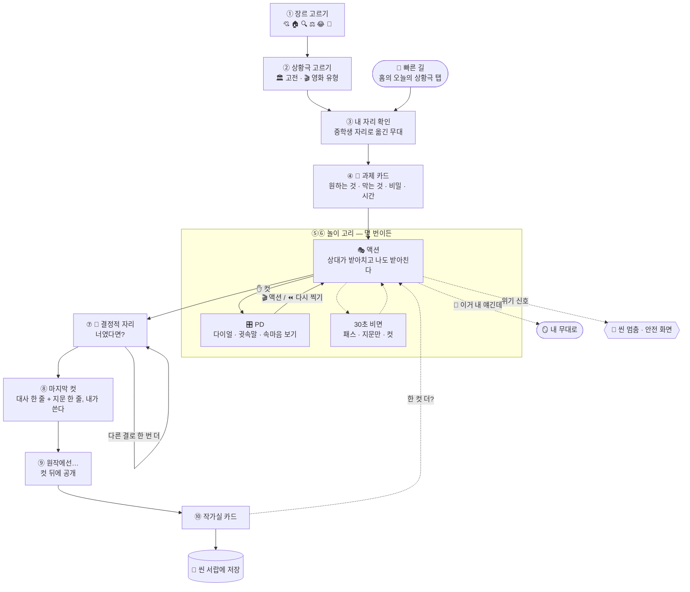

**화면별로 보이는 것**

| 화면 | 위 | 가운데 | 아래 (손이 닿는 곳) |
| --- | --- | --- | --- |
| 상황 카드 | 장르 · 맛 · 출처(🏛/🎬) | S#, 인물 카드, 고정 사실, 열린 것 | 🎯 과제 카드 · [들어가기] |
| 🎭 액션 | ⏱ 남은 시간 · 과제 한 줄 | 대사 말풍선 (상대 · 나), 지문은 기울임 | 입력창 · 🎙 · **✋ 컷**(크게) · 🪪 칩 |
| 🎛 PD | 「씬 멈췄어. 판 전체가 보여」 | 인물별 다이얼 4개 · 🟡 새 사실 보드 | 🤫 귓속말 · ⏪ 다시 찍기(비트 고르기) · 🎬 액션 |
| 🌟 나였다면? | 앞 비트 두 줄 | ⬜ 빈칸 하나 | 결 칩: 농담으로 · 질문으로 · 한 단어로 · 침묵으로 · 반대로 · 행동으로 |
| 원작 공개 | 「원작에선」 | 원어 짧게 + 우리가 새로 쓴 풀이 | 내 한 줄과 나란히 보기 |
| 작가실 | 카드 5장 넘기기 | ✅ 살아 있는 데 · ⚠️ · 🔎 · 🎥 PD 기록 · 🎬 | [한 컷 더] [서랍으로] |

- **반응하며 노는 게 중심이다.** 상대 인물은 매 비트 내 말의 **한 단어를 받아서** 돌려준다. 내가 농담하면 농담으로, 피하면 쫓아온다. 그래서 같은 상황극도 판마다 다르다.
- 도구는 ver1 그대로: 🔥🎭 다이얼 · 🤫 귓속말 · ⚡ 돌발 · 🔎 속마음 · 🟡 새 사실 · 30초 칩(`패스` `지문만` `컷`).
- 🐣 기초반은 ①②를 건너뛰는 빠른 길 — 홈의 「오늘의 상황극」 한 장을 탭.

### 6-1. 예시 — 🏛 시라노 → 「대신 쓰는 DM」 · 💘 · 🐣 × 🥛

```
S#.  학원 자습실 맨 뒤 / 밤 9시 40분 / 형광등 하나 깜빡
[출처]  🏛 시라노 — 대신 쓰는 편지
[상황]  짝 도윤이 「서아한테 DM 좀 대신 써 줘. 넌 글 잘 쓰잖아」. 폰을 내민다.
[인물]  🎭 하은 (주인공) — 원하는 것: 도윤을 도와주는 것. 숨기는 것: 하은도 서아랑 친해지고 싶다.
        도윤 — 원하는 것: 서아가 답장하는 것. 말버릇: 「아 그거 완전 나잖아」
[고정 사실]  · 폰은 도윤 거  · 학원 끝까지 20분  · 서아는 지금 온라인
[열린 것]    · 하은이 몇 줄을 쓰나  · 도윤이 그 문장을 읽고 뭘 느끼나  · 보내나
🎯 과제    🤐 비밀 지키기 — 내 마음은 안 들키고, 도윤 마음은 들키게
```

> **도윤:** *폰 내밀며* 「첫 줄만. 첫 줄이 제일 어려워.」
> 🖊 하은: 「…'오늘 학원 앞에서 너 웃는 거 봤어.' 이걸로 시작해.」
> **도윤:** 「아 그거 완전 나잖아. 근데 너 그걸 어떻게 알아?」 🟡 ← 반응: 내 문장의 「봤어」를 받아서 돌려줌
> ✋ 컷 → 🎛 도윤 👀 상대 보는 눈 1→3 → 🎬 액션
> **도윤:** *폰을 내리며* 「…야. 너도 봤던 거야? 그 웃는 거.」
> 🌟 하은: ⬜ ________________ ← 너였다면?
> 🖊 하은(가지 1): 「다들 봤지. 너만 본 줄 알았어?」 *폰을 도윤 쪽으로 다시 민다.*
> 마지막 컷(내가): 「네가 쳐. 네 말로.」 *도윤이 「오늘 학원 앞에서」까지 치고 멈춘다.*
> 🏛 원작에선 — 편지를 대신 써 준 사람은 끝까지 말하지 않았다. 아주 오래 뒤에, 편지를 소리 내 읽다가 들킨다.
> 🎬 작가실 — 「네가 쳐」. 원작은 대신 써 줬고, 너는 펜을 돌려줬어. 같은 자리, 다른 길.

---

# 4부 — 🪞 트랙 B · 내 무대: 사이코드라마 진행자와 함께

## 7. 진행자가 필요한 이유

내 장면을 처음부터 세우는 건 혼자 하기 어렵다. 어디서 시작할지, 얼마나 깊이 갈지, 언제 멈출지 — 그걸 같이 잡아 주는 사람이 사이코드라마의 **디렉터(진행자)**다. 마음씬의 AI 디렉터가 그 자리에 선다.

**사이코드라마의 자리 → 마음씬**

| 사이코드라마 | 마음씬 |
| --- | --- |
| 주인공 (protagonist) | **나** — 또는 나를 대신 세운 아바타(거리 두기) |
| 디렉터 | **AI 진행자** — 무대를 세우고 속도를 잡는다 |
| 보조자아 (auxiliary ego) | **AI 상대 인물** — 엄마, 친구, 그때의 나, 단톡방, 성적표 |
| 관객 | **객석의 나** — 컷 하고 밖에서 보는 나 |
| 무대 | 내가 세운 장소 · 시간 · 물건 하나 |

**진행자가 하는 것 / 안 하는 것**

| 하는 것 | 안 하는 것 |
| --- | --- |
| 「제일 또렷한 장면 하나만」 — 장면으로 좁힌다 | 「왜 그랬어?」 — 이유를 캐묻지 않는다 |
| 지금 여기 현재형으로 세운다 | 진단 · 병명 · 성격 유형을 붙이지 않는다 |
| 기법을 **제안**한다(고르는 건 나) | 해석해 주지 않는다. 내 말로만 되돌려 준다 |
| 무거워지면 속도를 늦추고 거리를 둔다 | 「이렇게 해」 정답을 주지 않는다 |
| 위기 신호면 무대를 접고 안전 흐름으로 | 밀지 않는다. 「여기까지」도 완결이다 |

## 8. 세 단계 — 웜업 → 행위 → 나눔

사이코드라마의 기본 순서를 그대로 쓰고, 기존 마음무대의 막 8개에 얹는다. 다음 막으로 넘어가는 건 **진행자가 제안하고, 넘기는 건 나**다.

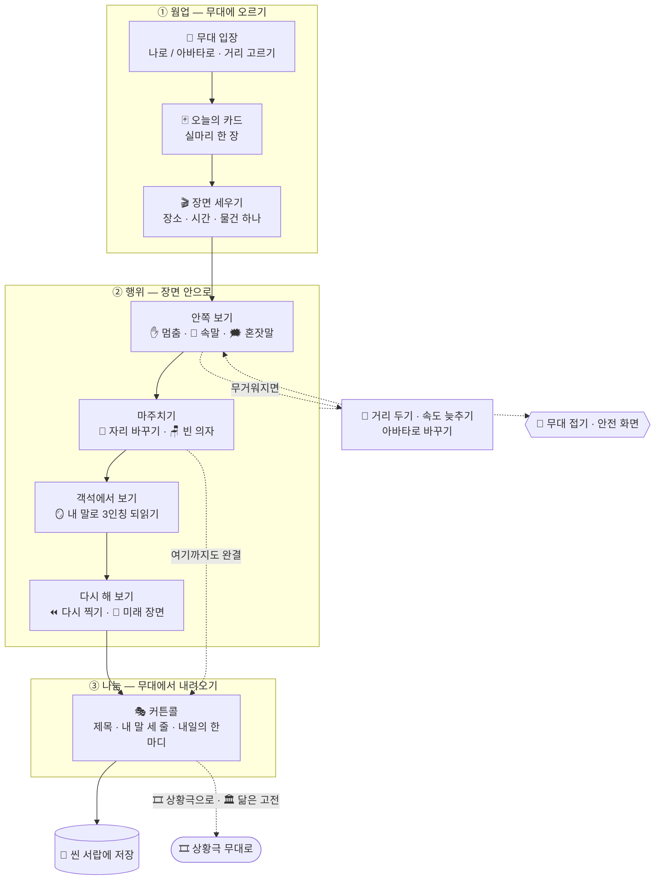

**진행자와 한 장면 — 누가 무엇을 하나** (§10 지후 판에서)

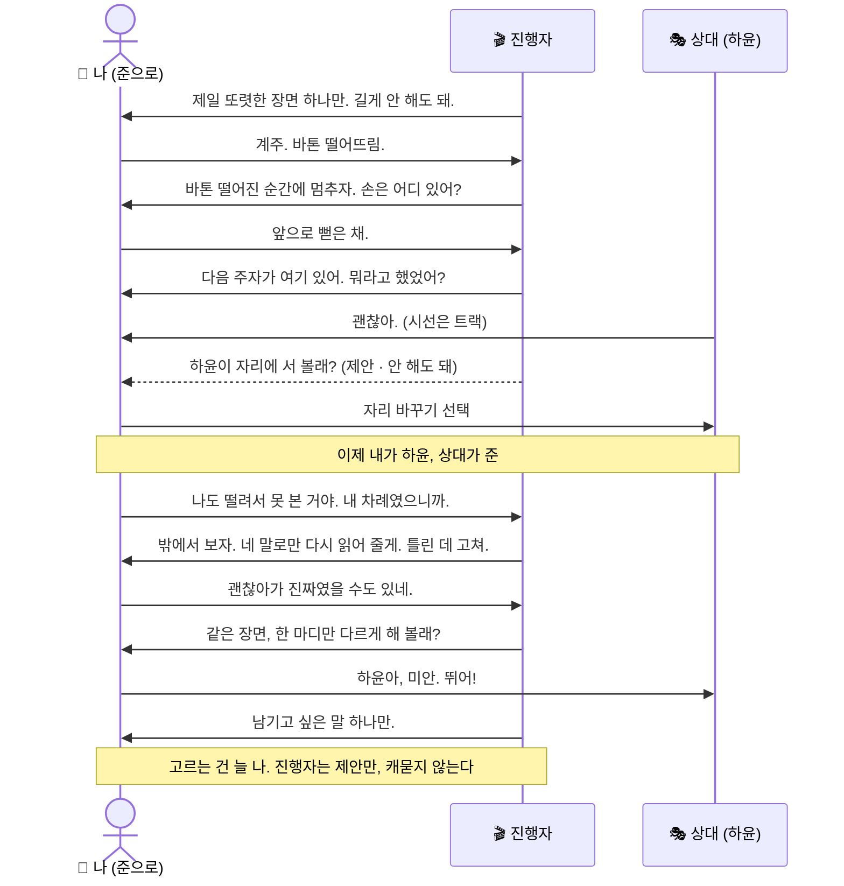

| 단계 | 막 | 진행자가 하는 것 | 쓰는 기법 | 진행자 한 줄 |
| --- | --- | --- | --- | --- |
| **① 웜업** | 무대 입장 | 대신 설 아바타 · 거리 고르기 | 거리 계약 | 「너 그대로 나와도 되고, 다른 이름으로 세워도 돼.」 |
| | 카드 뽑기 | 오늘의 실마리 한 장 | — | 「카드는 실마리일 뿐이야. 딴 얘기로 가도 돼.」 |
| | 1막 펼치기 | 이야기를 **장면 하나**로 | 장면 세우기 · 물건 하나 | 「그거 어디였어? 거기 뭐가 있었어? 하나만.」 |
| **② 행위** | 2막 안쪽 | 사건 말고 건드린 자리 | 멈춤 · 몸 먼저 · 속말 · 혼잣말 | 「거기서 멈추자. 그때 손은 어디 있었어?」 |
| | 3막 마주침 | 상대를 무대에 세운다 | 자리 바꾸기 · 빈 의자 · 거리 조절 | 「잠깐 엄마 자리에 서 볼래? 엄마는 거기서 뭐가 보였을까.」 |
| | 4막 거울 | 객석으로 나와 3인칭으로 본다 | 거울 · 3인칭 되읽기 | 「밖에서 보자. 내가 네 말로만 다시 읽어 줄게. 틀린 데 고쳐.」 |
| | 5막 리플레이 | 같은 장면, 다른 선택 | 다시 찍기 · 출구 깔기 · 미래 장면 | 「같은 장면, 한 번만 다르게. 정답 찾는 거 아니야.」 |
| **③ 나눔** | 커튼콜 | 제목 · 내 말 세 줄 · 내일의 한마디 | 나눔(셰어링) | 「오늘 네가 한 말 중에 남기고 싶은 거 하나만.」 |

## 9. 기법 사전 — 쉬운 이름으로

화면엔 **쉬운 이름**만 뜬다. 괄호 안 이름은 문서용.

| 쉬운 이름 | 사이코드라마 | 무대에서 | 언제 쓰나 |
| --- | --- | --- | --- |
| 🎬 장면 세우기 | scene setting | 장소 · 시간 · 빛 · 물건 하나를 현재형으로 | 「그냥 짜증 났어」를 장면으로 바꿀 때 |
| ✋ 멈춤 | freeze | 장면을 그 자리에 세워 둔다 | 말이 빨라지거나 막힐 때 |
| 💭 속말 | 이중자아 (double) | AI가 내 뒤에 서서 「혹시 이런 말?」 — 맞으면 가져가고 아니면 버린다 | 하고 싶은 말이 안 나올 때 |
| 🗯 혼잣말 | 독백 (soliloquy) | 상대한텐 안 들리는 말을 소리 내서 | 겉말과 속말이 다를 때 |
| 🔄 자리 바꾸기 | 역할 바꾸기 (role reversal) | 내가 상대가 되고, AI가 나를 한다 | 상대가 이해 안 될 때 · 다름을 볼 때 |
| 🪑 빈 의자 | empty chair | 여기 없는 사람에게 말한다 | 못 한 말, 지금은 못 만나는 사람 |
| 📏 거리 조절 | 공간 작업 | 상대를 가까이/멀리 놓는다 | 무거울 때 숨 쉴 자리 |
| 🪞 객석에서 보기 | 거울 (mirror) | 컷 하고 밖에서 내 장면을 본다 | 장면 안에서 길을 잃었을 때 |
| ⏪ 다시 찍기 | 재연 · 행동 연습 | 같은 장면, 다른 한 마디 | 다른 선택을 해 보고 싶을 때 |
| 🔭 미래 장면 | 미래 투사 | 일주일 뒤 · 1년 뒤의 같은 장소 | 「그래서 어떻게 될까」가 궁금할 때 |

## 10. 내 무대 한 판 — 예시 · 지후 · 🐣 × 🥛

> 상황극 서랍의 「뒤바뀐 사람」(빌린 체육복)을 하다가 🪪 「이거 내 얘긴데」를 누른 지후. 계주 바톤 일이 떠올랐다(ver1 §5-3).

| 단계 | 진행자 | 지후 | 무대 |
| --- | --- | --- | --- |
| 웜업 | 「너로 나와도 되고, 다른 이름도 돼.」 | 「다른 이름. 준.」 | 🎭 준(가명) |
| 장면 세우기 | 「제일 또렷한 장면 하나만. 길게 안 해도 돼.」 | 「계주. 바톤 떨어뜨림.」 | 운동장 · 오후 · 더움 · 바톤 소리 |
| 멈춤 | 「바톤 떨어진 순간에 멈추자. 준 손은 어디 있어?」 | 「앞으로 뻗은 채.」 | ✋ 정지 |
| 혼잣말 | 「거기서 아무한테도 안 들리는 말 하나 해도 돼.」 | 「…주워야 되는데 다리가 안 움직여.」 | 🗯 |
| 마주침 | 「다음 주자 하윤이가 여기 있어. 뭐라고 했었어?」 | 「괜찮아. 근데 나 안 봄.」 | AI 하윤: 「괜찮아.」 *시선은 트랙* |
| 자리 바꾸기 | 「하윤이 자리에 서 볼래?」 | (하윤으로) 「…나도 떨려서 못 본 거야. 내 차례였으니까.」 | 🔄 🟡 새 사실 |
| 객석에서 보기 | 「밖에서 보자. 네 말로만 읽을게.」 | (3인칭 되읽기를 듣고) 「'괜찮아'가 진짜였을 수도 있네.」 | 🪞 |
| 다시 찍기 | 「같은 장면, 한 마디만 다르게.」 | 준: *바톤 줍고* 「하윤아, 미안. 뛰어!」 | ⏪ 테이크 2 |
| 나눔 | 「남기고 싶은 말 하나만.」 | 「하윤도 떨렸다.」 | 📝 커튼콜 · 🧩 서랍 |

- 진행자는 그 기억이 어땠는지 **캐묻지 않았다.** 장면 · 몸 · 말만 다뤘다.
- 저장되는 것: 🧩 씬 조각 「계주, 바톤」 — 테이크 1(그때 한 것) · 테이크 2(그때 안 한 것).

---

# 5부 — 두 트랙의 연결

## 11. 다리 셋

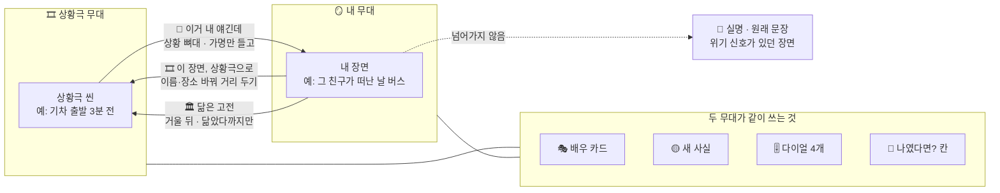


| 다리 | 방향 | 언제 뜨나 | 무엇이 넘어가나 | 진행자 한 줄 |
| --- | --- | --- | --- | --- |
| 🪪 **이거 내 얘긴데** | 🎞 → 🪞 | 상황극 화면에 늘 떠 있는 칩 | 장소 · 상황 뼈대 · 가명. 「내 무대」 웜업이 이 상황에서 시작 | 「그럼 가명 그대로 네 장면으로 옮길까? 아니면 여기서 그냥 놀아도 돼.」 |
| 🎞 **이 장면, 상황극으로** | 🪞 → 🎞 | 커튼콜 뒤 · 무거워서 쉬고 싶을 때 | 내 장면을 **남의 이야기**로 바꿔 준다 — 이름 · 장소를 바꾸고 상황 뼈대만 남겨 상황극 카드로 | 「이 장면, 다른 애 얘기로 바꿔서 놀이로 해 볼래? 거리 두고 보면 다르게 보여.」 |
| 🏛 **닮은 고전** | 🪞 → 🎞 | 거울 단계 뒤 | 내 장면과 구조가 닮은 고전 상황 하나 소개(해석 아님, 「닮았다」까지) | 「이 자리, 리어 왕 셋째 딸 자리랑 좀 닮았어. 그 애는 어떻게 했는지 상황극으로 볼래?」 |

**넘어가지 않는 것**
- 내 무대의 실명 · 원문 기록은 상황극으로 넘어가지 않는다. 넘어가는 건 **사용자가 「이건 가져가도 돼」로 고른 뼈대**뿐.
- 위기 신호가 있던 장면은 다리를 놓지 않는다. 안전 흐름으로.

## 12. 같이 쓰는 것

| 같이 쓰는 것 | 쓰임 |
| --- | --- |
| 🎭 배우 카드 | 상황극에서 만든 인물(예: 「눈치 빠른 짝」)을 내 무대의 보조자아로 불러온다. 그 반대도 |
| 🟡 새 사실 | 한 씬에서 생긴 새 사실을 PD가 골라 다음 씬으로 넘긴다 |
| 🎚 다이얼 | 솔직함 · 상대 보는 눈 · 고집 · 장난기 — 두 트랙 모두 같은 4개 |
| 🌟 결정적 자리 | 상황극의 「명대사 자리」 = 내 무대의 「그때 못 한 말」. 같은 칸, 같은 질문: **「나였다면?」** |

---

# 6부 — 조립: 씬 조각에서 한 편으로

## 13. 조립대

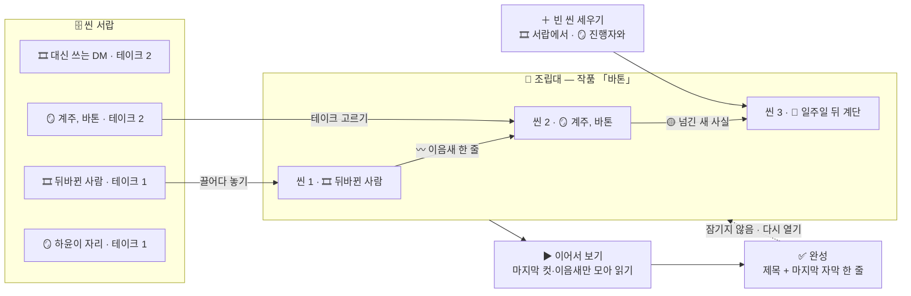

**조립대 화면 (스케치)**


```
┌ 조립대 ───────────────────────────────────────────┐
│ 씬 서랍                       내 무대 한 편: 「바톤」       │
│ 🎞 대신 쓰는 DM   (T2)          ┌──────────────────────┐ │
│ 🎞 뒤바뀐 사람    (T1)    ──▶   │ S#1 🎞 뒤바뀐 사람        │ │
│ 🪞 계주, 바톤     (T2)          │   〰 이음새: 「그날도 이름  │ │
│ 🪞 하윤이 자리    (T1)          │      이 바뀌어 불렸다」   │ │
│ 🎞 한 방의 열두 명 (T3)          │ S#2 🪞 계주, 바톤 (T2)   │ │
│                                │ S#3 🔭 일주일 뒤 계단     │ │
│ [＋ 빈 씬 세우기]               └──────────────────────┘ │
│                                 [제목] [이어서 보기] [완성] │
└───────────────────────────────────────────────────┘
```

| 하는 것 | 내용 |
| --- | --- |
| 놓기 | 서랍에서 씬 조각을 끌어다 순서대로. 조각마다 **어느 테이크**를 쓸지 고른다 |
| 이음새 | 씬과 씬 사이에 지문 한 줄을 내가 쓴다. 비워도 된다 |
| 빈 씬 세우기 | 사이에 필요한 장면이 없으면 그 자리에서 새로 세운다(🎞 서랍에서 고르거나 🪞 진행자와) |
| 🟡 넘기기 | 앞 씬의 새 사실 중 뒤로 넘길 것만 고른다 |
| 이어서 보기 | 처음부터 끝까지 한 번에 읽기(마지막 컷 · 이음새 · 자막만 모은 판) |
| 완성 | 제목 + 마지막 자막 한 줄. 완성해도 **잠기지 않는다** — 다시 열어 고칠 수 있다 |

## 14. 틀 세 가지 (고르지 않아도 됨)

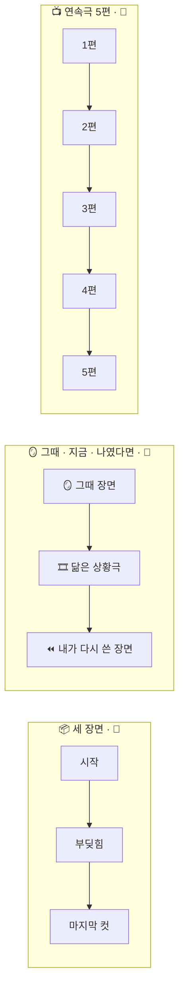


| 틀 | 씬 수 | 모양 | 잘 맞는 반 |
| --- | :---: | --- | --- |
| 📦 **세 장면** | 3 | 시작 → 부딪힘 → 마지막 컷 | 🐣 |
| 🪞 **그때 · 지금 · 나였다면** | 3 | 🪞 그때 장면 → 🎞 닮은 상황극 → ⏪ 내가 다시 쓴 장면 | 🐥 |
| 📺 **연속극** | 5편 | 같은 배 탄 인물 하나가 5편 내내 · 한 주에 한 편 (ver1 §19) | 🦅 |

- 🎞과 🪞 조각은 **섞어도 된다.** 각 씬에 출처 표시(🎞/🪞)가 남는다.
- 🪞 조각이 들어간 작품은 기본이 **나만 보기.** 공유는 사용자가 씬 단위로 고른 것만, 🪞 조각은 가명 확인을 한 번 더 거친다.

---

# 7부 — 수정과 기록: 고친 자리가 남는다

## 15. 원칙 — 덮어쓰지 않는다

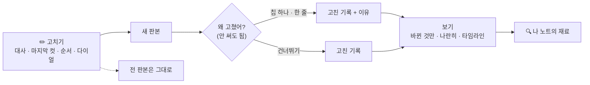


| 원칙 | 왜 |
| --- | --- |
| 고치면 **새 판본**이 생긴다. 전 판본은 남는다 | 실패가 아니라 테이크. 고친 자리가 곧 성찰의 재료 |
| 「왜 고쳤어?」는 **선택**이다 | 칩 한 번 또는 한 줄. 안 써도 저장된다 |
| 지우기는 있다. 다만 **정말 지울 때만** | 내 기록은 내 것. 지우면 진짜로 지운다(되살리기 없음, 한 번 더 확인) |
| 기록은 이 기기 안에 | 실명 저장 없음. 어른도 못 본다(ver1 §2-4) |

## 16. 고칠 수 있는 것 · 남는 기록

| 고치는 것 | 어디서 | 남는 기록 | 「왜 고쳤어?」 칩 |
| --- | --- | --- | --- |
| ⏪ 다시 찍기 | 씬 안 | 테이크 N | `다르게 해 보고 싶어서` `그때 못 한 말` `웃기게` `더 솔직하게` |
| ✏️ 대사 고치기 | 씬 서랍 | 그 줄의 전/후 | `이 말이 아니었어` `더 짧게` `진짜 내 말로` |
| 🎬 마지막 컷 바꾸기 | 씬 서랍 · 조립대 | 마지막 컷 판본 | `끝이 달라졌어` `아직 못 정했어` |
| 🎚 다이얼 바꾸기 | 🎛 PD | 다이얼 값 전/후 | (칩 없음 — 값만) |
| 🧩 순서 바꾸기 · 넣기 · 빼기 | 조립대 | 작품 판본 | `이야기가 달라졌어` |
| 🗒 이음새 · 자막 고치기 | 조립대 | 그 줄의 전/후 | — |

**보는 방법 세 가지**
- **바뀐 것만** — 판본 사이에 달라진 줄만 형광펜으로.
- **나란히** — 테이크 1 | 테이크 2 | 테이크 3, 같은 자리의 내 한 줄을 옆으로.
- **타임라인** — 이 작품을 언제, 무엇을, 왜 고쳤는지 날짜 순서로.

**한 작품이 자라는 모양 — 「바톤」**

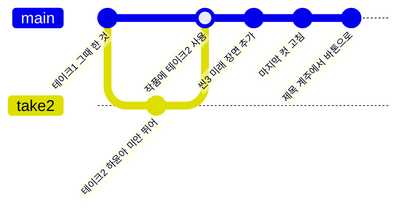

```
📖 「바톤」 고친 기록
10/13  S#2 테이크 2  ⏪ 「그때 못 한 말」          — 「하윤아, 미안. 뛰어!」
10/14  S#3 추가      🔭 미래 장면                  — 「일주일 뒤 계단」
10/16  S#2 마지막 컷  ✏️ 「진짜 내 말로」           — 「미안」 → 「다음엔 내가 볼게」
10/16  제목          「계주」 → 「바톤」
```

---

# 8부 — 성찰: 나를 알아가는 자리

## 17. 세 겹

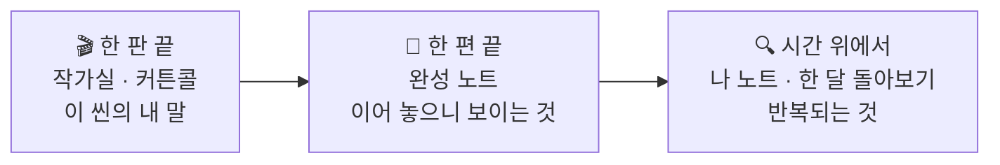


| 겹 | 언제 | 어디서 | 무엇을 본다 |
| --- | --- | --- | --- |
| 🎬 **한 판 끝** | 씬 하나 끝날 때 | 🎞 작가실 · 🪞 커튼콜 | 이 씬에서 내가 쓴 말 |
| 📖 **한 편 끝** | 작품을 완성할 때 | 완성 노트 | 씬들을 이어 놓으니 보이는 것 · 내가 고른 테이크 |
| 🔍 **시간 위에서** | 한 달에 한 번 / 내가 열 때 | **나 노트** | 여러 작품 · 여러 고침에 걸쳐 반복되는 것 |

## 18. 나 노트

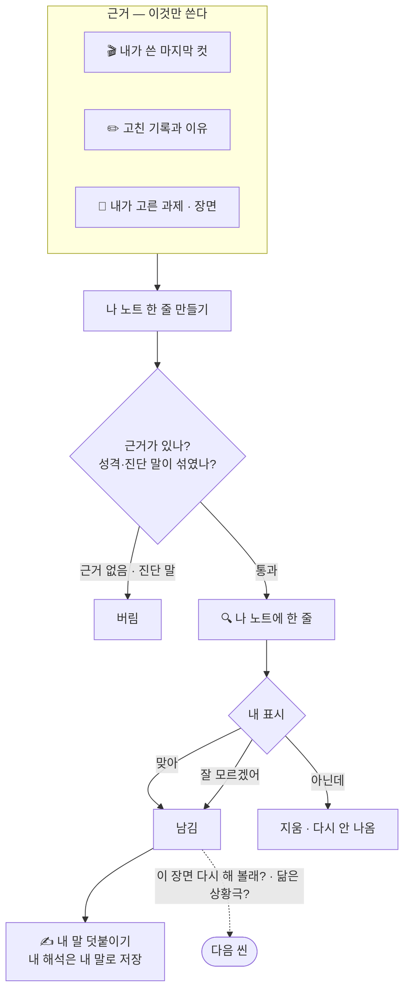


**근거는 딱 둘 — 내가 쓴 말, 내가 고친 자리.** AI가 짐작한 내 마음은 쓰지 않는다.

| 나 노트가 하는 말 (예) | 근거 |
| --- | --- |
| 「다시 찍을 때마다 마지막 컷이 '나중에'에서 '지금'으로 바뀌었어. 세 작품 다.」 | 마지막 컷 판본 3개 |
| 「자리 바꾸기를 하면 네 말이 두 배로 길어져.」 | 🪞 씬의 비트 길이 |
| 「상황극에서 넌 거의 늘 🗣 설득 과제를 골랐어. 근데 내 무대에선 ✋ 거절 장면이 많아.」 | 과제 선택 · 장면 유형 |
| 「'괜찮아'를 고친 게 네 번이야. 네 번 다 더 긴 말로 바뀌었어.」 | 대사 고치기 기록 |
| 「🎞에서 네가 만든 인물 '눈치 빠른 짝'이 🪞 장면에 두 번 불려 왔어.」 | 배우 카드 사용 |

**나 노트가 하지 않는 것**
- 「너는 회피형이야」 같은 **성격 · 유형 · 진단 이름** 없음.
- 「이렇게 해 봐」 같은 **처방** 없음.
- 점수 · 그래프로 된 「성장 지표」 없음. 성찰은 숫자가 아니라 **내 문장 나란히 보기**다.

**나 노트에서 할 수 있는 것**
- 각 줄에 `맞아` `아닌데` `잘 모르겠어` — 「아닌데」를 누르면 그 줄은 사라지고 다시 안 나온다.
- 한 줄 덧붙이기 — **내가 쓴 해석**은 나 노트에 「내 말」로 남는다.
- 그 줄에서 바로 가기 — 「이 장면 다시 찍어 볼래?」 / 「닮은 상황극 하나 해 볼래?」

**진행자 한 줄**

| 자리 | 진행자 |
| --- | --- |
| 나 노트 열 때 | 「네가 쓴 말만 모아 놨어. 맞는지는 네가 정해.」 |
| 반복이 보일 때 | 「이거 세 번째야. 알고 있었어? 몰랐어도 괜찮아.」 |
| 「아닌데」 눌렀을 때 | 「알았어, 지울게. 네가 제일 잘 알지.」 |
| 한 달 돌아보기 | 「이번 달 네 마지막 컷들, 나란히 놓아 볼까?」 |

---

# 9부 — 유저 시나리오: 하은의 2주

> 💘 하은 · 중2 · 「드라마 보면서 대사 따라 함」(ver1 §2-2). 🐣 × 🥛에서 시작한다.

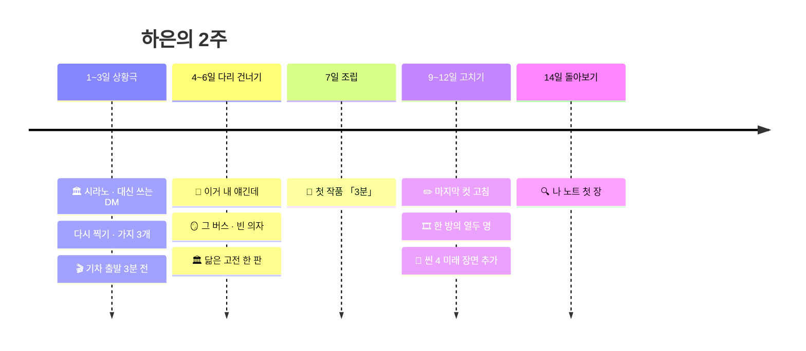

**하은의 마음 온도** (1 = 시큰둥 · 5 = 신남 · 사용자 테스트에서 확인할 가설)

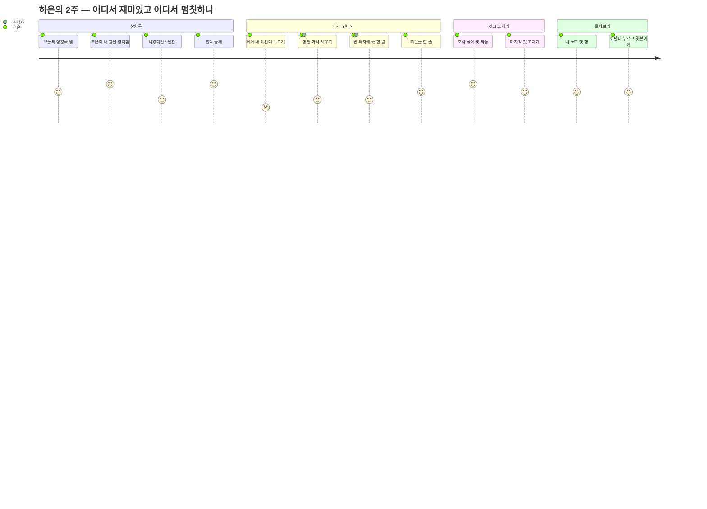

> 점수가 낮은 자리(「이거 내 얘긴데」 2점)가 **UI가 제일 신경 써야 할 자리**다 — 누르는 순간이 부담스럽지 않게, 「여기서 그냥 놀아도 돼」가 같은 화면에 같이 보여야 한다.

| 날 | 트랙 | 하는 것 | 남는 것 |
| :---: | :---: | --- | --- |
| 1 | 🎞 | 홈 「오늘의 상황극」 → 🏛 시라노 「대신 쓰는 DM」(§6-1). 컷 1번 | 🧩 테이크 1 |
| 2 | 🎞 | 같은 씬 ⏪ 다시 — 도윤 솔직함 3. 🌟 자리에 가지 2개 | 🧩 테이크 2 · 3 · 「가지 나란히」 |
| 3 | 🎞 | 💘 장르 서랍 → 🎬 「기차 출발 전」 → 전학 가는 날 정류장 | 🧩 새 조각 |
| 4 | 🎞→🪞 | 정류장 씬에서 🪪 「이거 내 얘긴데」 — 초등 친구가 다른 학교로 간 날 | 🪞 내 무대 웜업 시작 |
| 5 | 🪞 | 장면 세우기 → 멈춤 → 🪑 빈 의자로 그 친구에게 못 한 말 → 🪞 객석에서 보기 | 🧩 「그 버스」 테이크 1 · 커튼콜 |
| 6 | 🪞→🎞 | 커튼콜 뒤 🏛 닮은 고전: 「떠나는 사람과 남는 사람」 — 놀이로 한 판 | 🧩 상황극 조각 |
| 7 | 📖 | 조립대 — 틀 「그때 · 지금 · 나였다면」: 🪞 그 버스 → 🎞 기차 출발 전 → ⏪ 그 버스 테이크 2 | 📖 첫 작품 「3분」 |
| 9 | ✏️ | 「3분」 S#3 마지막 컷 고치기 — 「잘 가」 → 「주말에 와」 · 칩 `진짜 내 말로` | 고친 기록 1 |
| 11 | 🎞 | ⚖️ 「한 방의 열두 명」 — 반티 투표 28:1 | 🧩 |
| 12 | ✏️ | 「3분」에 S#4 🔭 미래 장면 추가 — 「한 달 뒤, 그 애가 진짜 주말에 왔다」 | 작품 판본 2 |
| 14 | 🔍 | 나 노트 첫 장 | 아래 |

**14일째 나 노트**

> - 「네 마지막 컷 다섯 개 중 넷이 **질문**으로 끝나. '주말에 와?' '네가 칠래?'」 → 하은: `맞아` + 덧붙임 「답을 내가 정하는 게 무서운가 봐」
> - 「상황극에선 도와주는 자리를 골랐고, 내 무대에선 남겨진 자리였어.」 → `잘 모르겠어`
> - 「'잘 가'를 '주말에 와'로 고쳤어. 고친 이유: 진짜 내 말로.」
>
> 진행자: 「네가 쓴 말만 모았어. 덧붙인 한 줄은 네 말로 남겨 둘게.」

**이 시나리오가 확인하는 것** — ① 🎞에서 🪞로 다리를 건너나 ② 🪞 조각을 조립대에 넣나 ③ 완성한 작품을 다시 열어 고치나 ④ 나 노트에서 「아닌데」/덧붙임을 쓰나.

**다른 길도 같은 구조로**
- 🔍 민재(중3) — 🎞 추리만 계속해도 된다. 서랍에 쌓인 상황극 조각만으로 「세 장면」 작품. 🪞에 안 가도 나 노트는 생긴다(🎞 마지막 컷만으로).
- 🌱 지후(중1) — 🎞 「뒤바뀐 사람」 → 🪪 → 🪞 「계주, 바톤」(§10) → 🔭 미래 장면으로 작품 「바톤」(§16 예시).

---

# 10부 — 화면과 진행

## 19. 홈

```
┌ 마음씬 ─────────────────────────────────────┐
│ 지금 어디쯤이야?  [ 중2 ▾ ]                      │
│                                              │
│ 🎞 상황극 무대                                  │
│  오늘의 상황극 ▸ 「대신 쓰는 DM」 🏛 · 3분          │
│  [💘] [🏠] [🔍] [⚖️] [😂] [🌱]  ← 장르 서랍       │
│                                              │
│ 🪞 내 무대                                      │
│  「장면 하나만 세워 볼래? 진행자가 같이 있어.」      │
│  [ 시작 ]                                      │
│                                              │
│ 📖 조립 중: 「3분」 S#3/4   ·  🗄 씬 서랍 12        │
│ 🔍 나 노트  (새 줄 2)                           │
│ ─────────────────────────────────────────── │
│ 🐣 기초반 · 다 보기          🌶🌶 진한 방 · 🔥 따로 │
└──────────────────────────────────────────────┘
```

## 20. 화면 목록 — 열네 장

| # | 화면 | 들어오는 곳 | 핵심 요소 | 제일 큰 버튼 | 나가는 곳 |
| :---: | --- | --- | --- | --- | --- |
| 1 | 🏠 홈 | 앱 열기 | 시기 고르기 · 오늘의 상황극 · 내 무대 입구 · 조립 중 · 나 노트 새 줄 | 오늘의 상황극 | 2 · 3 · 8 · 11 · 14 |
| 2 | 🎞 장르 서랍 | 홈 장르 칩 | 장르별 상황극 카드 (🏛/🎬 표시 · 맛 · 3분/10분) | 카드 한 장 | 3 |
| 3 | 📜 상황 카드 | 서랍 · 오늘의 상황극 | 장소 · 인물 카드 · 고정 사실 · 열린 것 · 🎯 과제 | 들어가기 | 4 |
| 4 | 🎭 액션 | 상황 카드 · PD | 말풍선 · 지문 · ⏱ · 🪪 칩 · 30초 칩 | ✋ 컷 | 5 · 6 · 8 |
| 5 | 🎛 PD | 액션에서 컷 | 다이얼 · 🟡 새 사실 보드 · 귓속말 · 테이크 목록 | 🎬 액션 | 4 |
| 6 | 🌟 나였다면? → 마지막 컷 | 액션 끝 | 빈칸 하나 · 결 칩 · 대사 한 줄 + 지문 한 줄 | 이걸로 끝 | 7 |
| 7 | 🏛 원작 공개 + 작가실 | 마지막 컷 | 원작 풀이 · 내 한 줄 나란히 · 카드 5장 | 서랍으로 | 11 · 4 |
| 8 | 🚪 내 무대 입장 | 홈 · 🪪 다리 | 나로 / 아바타로 · 거리 슬라이더 · 오늘의 카드 | 시작 | 9 |
| 9 | 🎬 내 무대 | 입장 | 장면 판(장소·물건) · 대화 · **기법 칩 줄** · ✋ 멈춤 | 다음 장면으로(제안일 때만) | 10 · 13 |
| 10 | 🎭 커튼콜 | 내 무대 끝 · 어느 때나 | 제목 · 내 말 세 줄 · 내일의 한마디 · 다리 칩 둘 | 서랍으로 | 11 · 3 |
| 11 | 🗄 씬 서랍 | 작가실 · 커튼콜 · 홈 | 씬 조각 카드(🎞/🪞 · 테이크 수 · 날짜) · 필터 | 조립대로 | 12 |
| 12 | 📖 조립대 | 서랍 | 슬롯 · 이음새 · 테이크 고르기 · 이어서 보기 · 고친 기록 탭 | 완성 | 14 |
| 13 | 🛟 안전 | 어디서든 위기 신호 | 씬 멈춤 · 지금 기분 한 칸 · 같이 말할 수 있는 어른 카드 | 지금 연락하기 | 홈 |
| 14 | 🔍 나 노트 | 홈 · 완성 뒤 | 근거 달린 줄 · 맞아/아닌데/잘 모르겠어 · 덧붙이기 · 한 달 돌아보기 | 이 장면 다시 해 보기 | 3 · 9 |

## 21. UI 원칙 — 열세 살이 처음 켰을 때

| 원칙 | 화면에서 |
| --- | --- |
| **한 화면 한 동작** | 액션 화면의 주인공은 ✋ 컷 하나. 다른 도구는 PD 화면에만 |
| **두 무대는 색으로 구분** | 🎞 상황극 = 밝은 무대 조명 톤 · 🪞 내 무대 = 낮은 객석 조명 톤. 씬 조각 카드 모서리에도 같은 색 |
| **글자 대신 말로도** | 모든 입력에 🎙. 30초 비면 칩 3개(패스 · 지문만 · 컷) — 「아무것도 안 해도 괜찮아」가 보이게 |
| **나가는 문이 늘 보인다** | 모든 씬 화면 오른쪽 위에 ✋. 내 무대에선 「여기까지」 버튼이 같은 자리에 |
| **다리는 칩, 강요는 없음** | 🪪 칩 옆에 「여기서 그냥 놀아도 돼」를 같이 둔다. 누르지 않아도 아무 일 없다 |
| **저장 버튼이 없다** | 끝나면 자동으로 서랍에. 「저장할까?」 묻지 않는다 |
| **고친 자리는 형광펜** | 판본 비교는 바뀐 줄만 노란 형광펜. 빨간색(틀림) 안 씀 |
| **숫자 없는 화면** | 점수 · 레벨 · 연속 출석 없음. 서랍에 쌓인 씬 카드 수만 |
| **진행자 말은 말풍선 하나** | 진행자 한 줄은 늘 한 문장 · 쉬운 말 · 물음표 하나. 긴 설명은 접어 둔다 |

**액션 ⇄ PD 전환 (상황극의 핵심 화면)**

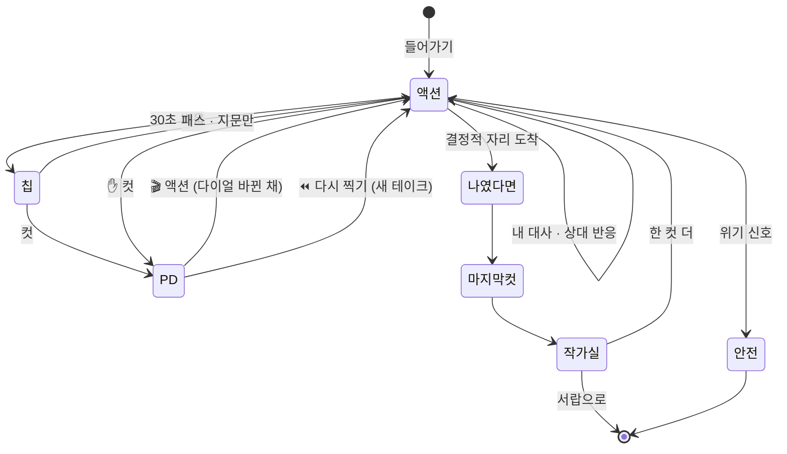

**내 무대 화면 (스케치)**

```
┌ 🪞 내 무대 · 준(아바타) ─────────────── ✋ 여기까지 ┐
│  🎬 운동장 · 오후 · 더움 · 🏃 바톤                     │
│ ─────────────────────────────────────────── │
│  🎬 진행자  바톤 떨어진 순간에 멈추자. 손은 어디 있어?    │
│  🙋 준      앞으로 뻗은 채.                            │
│  🎭 하윤    괜찮아.  (시선은 트랙)                      │
│ ─────────────────────────────────────────── │
│  해 볼 수 있는 것 (안 해도 돼)                          │
│  [✋ 멈춤] [💭 속말] [🗯 혼잣말] [🔄 자리 바꾸기] [🪑 빈 의자] │
│ ─────────────────────────────────────────── │
│  [ 말하거나 써도 돼…                    ] 🎙  보내기   │
└──────────────────────────────────────────────┘
```

## 22. 진행 순서

| 단계 | 만드는 것 | 확인하는 것 |
| :---: | --- | --- |
| 0 데이터 | 🎞 원형 12개(장르 6 × 2) · 🥛 번안 · 🏛 공개문 새 번역 · 🎬 고유 요소 빼기 체크리스트 | 두 사람이 읽고 원작 영화 제목을 못 맞힘 |
| 1 씬 한 판 | 🎞 상황극 한 판(과제 카드 · 반응 · 컷 · 다시 찍기 · 원작 공개) + `ScenePiece` 저장 | 컷을 누르나 · 같은 대사를 다시 치나 |
| 2 내 무대 | 🪞 웜업 → 행위 → 나눔, 기법 칩 6개(장면 세우기 · 멈춤 · 속말 · 혼잣말 · 자리 바꾸기 · 객석에서 보기) | 장면 하나까지 가나 · 자리 바꾸기를 쓰나 |
| 3 다리 · 조립 | 다리 셋 · 조립대 · 틀 3개 · 이어서 보기 | 🎞→🪞 건너나 · 섞어서 작품을 만드나 |
| 4 기록 · 성찰 | 고친 기록(보기 3가지) · 나 노트(근거 필수 · 맞아/아닌데) | 완성작을 다시 고치나 · 나 노트에 덧붙이나 |

## 23. 정해진 것 / 남은 것

**정해진 것**
- 이름 **마음씬**. 「마음무대」는 🪞 내 무대 트랙 이름으로 남고, 「컷!」은 버튼.
- 기본 단위는 **씬 조각.** 두 트랙이 같은 모양을 만들고, 조립대에서 한 편으로 완성한다.
- 🎞 상황극은 **고전과 영화의 상황**에서 온다. 고전은 상황 + 숨긴 명대사 자리, 영화는 상황의 뼈대만. 대사는 0줄.
- 🪞 내 무대는 **사이코드라마 진행자**가 웜업 → 행위 → 나눔으로 같이 간다. 제안만 하고 캐묻지 않는다.
- 고치면 판본이 남는다. 나 노트는 내가 쓴 말과 고친 자리만 근거로 한다. 진단 없음.
- 기본은 여전히 🐣 × 🥛. 진한 방 · 따로 만든 방 · 안전 흐름은 ver1 6부 그대로.

**남은 것**
1. 「마음씬」 상표 · 스토어 검색 확인. 막히면 「속무대」.
2. 🎬 영화 원형의 법률 검토 — 「유형」과 「특정 작품」의 경계 체크리스트 확정(최종.md §19-2와 같이).
3. 🎞→🪞 다리를 처음 몇 판엔 숨길지, 처음부터 보일지 — 첫 테스트에서 확인.
4. 나 노트 첫 등장 시점 — 씬 5개? 작품 1편? 「아닌데」 비율로 조정.
5. 🪞 조각이 들어간 작품의 공유 범위 — 기본 비공개로 두되, 수업용 묶음엔 🎞만.
6. 지우기(완전 삭제)와 「고친 기록은 남는다」의 경계 — 작품 삭제 시 고친 기록도 같이 지우는 것으로 안.

---

## 부록 A — ver1 → ver2 무엇이 바뀌었나

| | ver1 | ver2 |
| --- | --- | --- |
| 이름 | 컷! (씬 무대) + 마음무대(깊은 무대) | **마음씬** — 상황극 무대 · 내 무대. 「컷!」은 버튼 |
| 중심 | 씬 무대 하나, 깊은 무대는 옆문 | **씬 조각**이 중심, 두 트랙이 같은 무게 |
| 상황극 재료 | 추리 씬 · 조립 · 고전 각색(🌟) | **고전 + 영화 상황 유형**을 장르 서랍으로. 연기 실습식 과제 카드 |
| 내 이야기 | 기억 씬 다섯 걸음 (씬 무대 안) | 🪞 **내 무대** — 사이코드라마 진행자, 웜업 → 행위 → 나눔, 기법 사전 |
| 연결 | 「이거 내 얘긴데」 한 방향 | 다리 셋 — 양방향 + 닮은 고전 |
| 완성 | 단막극(씬 7개) | **조립대** · 틀 3개 · 완성 뒤에도 열림 |
| 기록 | 테이크 저장 | **고친 기록** — 바뀐 것만 · 나란히 · 타임라인 · 「왜 고쳤어?」 |
| 끝에 남는 것 | 작가실 카드 | 작가실 · 커튼콜 + **나 노트**(성찰) |

---

## 부록 B — 개발 메모 (참고)

> 이 문서는 시나리오와 화면이 중심이다. 아래는 개발로 넘길 때 참고할 메모만 남긴다.

### B-1. 데이터

```ts
// 씬 조각 — 두 트랙 공통
type SceneSource =
  | { track: "situation"; archetypeId: string; origin: "classic" | "film" }   // 🎞
  | { track: "inner"; sessionId: string; aliasOnly: true };                   // 🪞 실명 저장 없음

type ScenePiece = {
  id: string; title: string; source: SceneSource;
  scene: Scene;                         // 최종.md §2 형식 (장소·인물·고정 사실·열린 것)
  task?: ActingTask;                    // 🎞 과제 카드
  pivot: { prompt: string };            // 🌟 결정적 자리
  takes: Take[];                        // 지우지 않음
  spice: Spice; class: Class;
};

type ActingTask = {
  kind: "persuade" | "ask" | "refuse" | "secret" | "confess" | "apologize"
      | "deliver" | "uncover" | "deadline" | "loop";
  want: string; obstacle: string; secret?: string; timer?: number; body?: string;
};

type Archetype = {                      // 🎞 상황극 원형
  id: string; genre: Genre; origin: "classic" | "film";
  classicTitle?: string;                // 🏛만. 🎬은 앱에 노출하는 제목 없음
  skeleton: string;                     // 상황의 뼈대
  adaptations: Record<Spice, Scene | null>;   // 맛별 번안. 없으면 안 만듦
  reveal?: { original: string; ourGloss: string; after: string };  // 🏛 컷 뒤 공개
};

type Take = { n: number; beats: Beat[]; lastCut: { line: string; direction: string };
              dials: Dials; createdAt: string };

// 조립
type Work = {
  id: string; title: string; frame: "three" | "then-now-if" | "serial";
  slots: { pieceId: string; takeN: number; seam?: string; carryFacts: string[] }[];
  caption?: string; revisions: Revision[]; shareable: string[];  // 공유는 씬 단위로 고른 것만
};

// 고친 기록
type Revision = {
  at: string; target: { pieceId?: string; workId?: string; field: string };
  before: string; after: string;
  reason?: { chip?: string; note?: string };            // 선택
};

// 나 노트 — 근거는 사용자 말·고침뿐
type Insight = {
  id: string; text: string;
  evidence: { kind: "lastCut" | "revision" | "taskChoice" | "beatLength" | "castReuse"; refs: string[] }[];
  userMark?: "yes" | "no" | "unsure";   // "no"면 숨기고 같은 근거로 다시 안 만듦
  userNote?: string;                    // 내가 쓴 해석은 내 말로 저장
};
```

- 🎞 상대 인물 프롬프트(`improvTask`)에 한 줄 — 「사용자 말의 한 단어를 받아서 반응한다. 판을 대신 끝내지 않는다.」
- 🪞 진행자 프롬프트(`prompts.ts`)에 한 줄 — 「기법은 제안만 한다. 이유를 캐묻지 않는다. 해석하지 않고 사용자의 말로 되돌려 준다.」
- 나 노트 생성(`insightTask`) — 입력은 `lastCut` · `Revision` · 선택 기록만. 출력 문장마다 `evidence` 필수, 근거 없는 문장은 버린다. 성격·진단 단어 필터.

### B-2. 기존 코드에 얹는 자리

| 새 것 | 얹는 자리 | 메모 |
| --- | --- | --- |
| 🪞 내 무대 | [lib/stage.ts](../frontend/lib/stage.ts) 막 8개 그대로 + 기법 칩 | 개입 패턴은 [디렉터_개입패턴.md](마음무대_디렉터_개입패턴.md) |
| 🎞 상황극 | [app/play](../frontend/app/play/page.tsx) `mode: "acting" \| "pd"` (ver1 §8) | 데이터 `data/archetypes.json` |
| 씬 조각 · 서랍 | [lib/store.ts](../frontend/lib/store.ts) 로컬 저장 확장 · [app/drawer](../frontend/app/drawer) | 두 트랙이 같은 `ScenePiece`로 저장 |
| 조립대 | [app/story](../frontend/app/story) | `Work` |
| 다시 찍기 · 분기 | [lib/branches.ts](../frontend/lib/branches.ts) | 테이크 = 판본 |
| 고친 기록 | `Revision` 새 로컬 테이블 | 덮어쓰기 금지 |
| 나 노트 | 새 라우트 `app/api/insight` | 근거 없는 문장 차단 |
| 매 줄 안전 | [lib/safety.ts](../frontend/lib/safety.ts) `checkSafety` | 두 트랙 · 고친 대사 · 나 노트 덧붙임 모두 |
