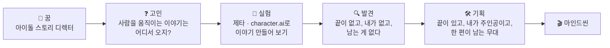

# 🎬 마인드씬(MindScene) — 지원 영상 3분 대본 v2

> **LG AI 청소년 캠프 4기 지원 영상 「나만의 AI 문제 해결 아이디어」**
> 프로토타입: https://teen-dramaro.vercel.app/about
> 역할: **기획자** (꿈: 아이돌의 스토리를 기획하는 디렉터)
> 화면 속 서비스 이름은 **마음씬** — 영상에서는 "마인드씬(마음씬)"으로 한 번 소개하고 이후 통일

---

## 0. 이번 버전에서 바뀐 점

| | v1 | **v2** |
|---|---|---|
| 동기 | 친구들이 써서 나도 써 봤다 | **스토리 디렉터를 꿈꾸는 기획자로서** 공부하려고 제타·character.ai를 써 봤고, **기획자의 눈으로 빠진 것**을 찾았다 |
| 설명 | 말로 기능 나열 | **About 페이지를 위에서 아래로 스크롤하며** 설명 |
| 시연 | 짧은 화면 녹화 | **〈시라노〉 씬 한 편을 실제로 끝까지** 해 보는 시연 (40초) |
| 강조 | 기능 3가지 | **차별점 4가지 + 쓰면 좋은 점 3가지**를 화면 자막으로 고정 |

---

## 1. 이야기의 뼈대 (한 줄씩)

> **핵심 메시지:** "좋은 스토리는 **진짜 마음**에서 나온다. 그런데 AI 캐릭터 채팅은 그 마음을 꺼내 주지 않았다. 그래서 **진짜 마음을 한 씬씩 꺼내는 무대**를 기획했다."

---

## 2. 요강 체크

| 요강 항목 | 대본 위치 |
|---|---|
| ① 일상의 문제 + **왜 그 문제를 골랐는지** | #1 ~ #3 (0:00 – 0:55) |
| ② AI로 어떻게 해결할지 + **나의 역할(기획자)** | #4 ~ #7 (0:55 – 2:35) |
| ③ AI 서비스에 **어떤 질문**으로 도움을 받았는지 | #8 (2:35 – 2:50) |
| 분량 1~3분, **본인 직접 출연** | 2분 58초 목표 · 얼굴 PIP 상시 |

---

## 3. 타임라인

| 시간 | 파트 | 화면 |
|---|---|---|
| 0:00 – 0:12 | #1 오프닝 — 내 꿈 | 얼굴 정면 |
| 0:12 – 0:35 | #2 기획자로서의 고민 → 제타·character.ai 실험 | 얼굴 + 앱 화면 B-roll |
| 0:35 – 0:55 | #3 기획자의 눈으로 찾은 빈칸 3가지 | 얼굴 + 자막 3줄 |
| 0:55 – 1:20 | #4 About 페이지로 소개 | About 스크롤 녹화 + 얼굴 PIP |
| 1:20 – 2:00 | #5 **시연 — 〈시라노〉 씬 한 편** | 앱 녹화 + 얼굴 PIP |
| 2:00 – 2:20 | #6 차별점 · 쓰면 좋은 점 | About 「돌아보기·약속」 + 비교표 자막 |
| 2:20 – 2:35 | #7 나의 역할 — 기획자 | 얼굴 + 기획 노트 |
| 2:35 – 2:50 | #8 AI에게 받은 도움 | AI 대화 캡처 |
| 2:50 – 2:58 | #9 클로징 | 얼굴 정면 |

---

## 4. 대본

> 💡 `[ ]` 안은 **실제 경험·실제 숫자**로 바꿔 주세요. 외우기보다 **내 말투로** 말하는 게 훨씬 좋아요.

### 🎬 #1 오프닝 — 내 꿈 (0:00 – 0:12)
**화면:** 얼굴 정면

> 안녕하세요, [이름]입니다.
> 제 꿈은 **아이돌의 스토리를 기획하는 디렉터**예요.
> 오늘은 그 꿈을 고민하다가 직접 만들게 된 서비스, **마인드씬**을 소개하려고 합니다.

**자막:** `꿈: 아이돌 스토리 디렉터`

---

### 🎬 #2 기획자로서의 고민 → 실험 (0:12 – 0:35)
**화면:** 얼굴 → 제타 / character.ai 화면 캡처 2~3초 (캐릭터 이름·프로필은 흐리게)

> 코르티스 같은 그룹을 보면, 사람들이 빠져드는 건 화려한 무대보다 **그 사람의 진짜 이야기**더라고요.
> 그래서 늘 궁금했어요. **"사람을 움직이는 스토리는 어디서 시작될까?"**
>
> 스토리 기획을 연습해 보려고, 요즘 친구들이 많이 쓰는 **제타랑 character.ai**로 직접 이야기를 만들어 봤어요.
> 캐릭터도 만들고, 장면도 짜고, [일주일 동안 ○시간] 넘게 대화했어요.

---

### 🎬 #3 기획자의 눈으로 찾은 빈칸 (0:35 – 0:55)
**화면:** 얼굴 클로즈업 + 한 줄씩 뜨는 자막

> 재밌었어요. 그런데 **기획자의 눈으로 다시 보니까** 세 가지가 빠져 있었어요.
>
> **첫째, 끝이 없어요.** 좋은 이야기엔 시작과 갈등과 마지막 장면이 있는데, 채팅은 그냥 계속 이어져요.
> **둘째, 내가 없어요.** 주인공은 AI 캐릭터고, 나는 거기 맞춰 주기만 했어요.
> **셋째, 남는 게 없어요.** 몇 시간을 썼는데, 닫고 나면 **'내 이야기'는 한 줄도 없었어요.**
>
> AI 캐릭터 앱을 쓰는 청소년이 [150만 명]이 넘는다는데, 다들 이 시간을 이렇게 흘려보내고 있는 거예요.
> 그래서 생각했어요. **AI랑 대화만 하는 게 아니라, AI랑 같이 '내 이야기 한 편'을 만드는 곳이 있으면 어떨까?**
> 찾아봐도 없어서, **직접 기획하고 만들었습니다.**

**자막(차례로):** `① 끝이 없다` → `② 내가 없다` → `③ 남는 게 없다`
> ⚠️ [150만 명]은 기사 출처를 확인하고 숫자·기사 이름을 자막에 작게 넣기

---

### 🎬 #4 About 페이지로 소개 (0:55 – 1:20)
**화면:** `teen-dramaro.vercel.app/about` 을 **위에서 아래로 천천히 스크롤**, 오른쪽 아래 얼굴 PIP
→ 말하는 문장과 화면 섹션이 **딱 맞게** 스크롤 멈추기

| 말 | 그때 보이는 About 섹션 |
|---|---|
| "마인드씬은 **내 안의 무대, 한 씬씩**이라는 뜻이에요." | 히어로 「내 안의 무대, 한 씬씩.」 |
| "한 판은 **5분**, 진단도 점수도 **0**, 기록은 **내 폰에만** 남아요." | 숫자 4개 (5분 · 🥛 · 0 · 📱) |
| "**고르고, 씬 하고, 모으는** 세 단계예요." | 「처음이라면 이렇게 3단계」 |
| "씬은 카메라가 안 끊기는 **한 테이크짜리 작은 이야기**예요. **시작 – 흔들림 – 마지막 컷**." | 「씬 — 한 테이크, 한 편」 |
| "입구는 둘이에요. 유명 장면으로 **노는 🎞 상황극**, 내 장면을 **털어놓는 🪞 내 무대**." | 「두 무대 — 놀거나, 털어놓거나」 |
| "그리고 얼마나 깊이 갈지는 **내가 골라요.** 기본은 🥛 순한 맛." | 「맛 — 순한 맛부터, 천천히」 |

> 정리 멘트: **"말로 설명하는 것보다, 직접 한 씬 보여 드릴게요."** → 「시라노 해 보기 ›」 클릭으로 #5 연결

---

### 🎬 #5 시연 — 〈시라노〉 씬 한 편 (1:20 – 2:00) ⭐ 가장 중요
**화면:** 앱 녹화 전체 + 얼굴 PIP. 각 컷 3~6초, 빨리감기(×2~×4) 적극 사용

| # | 화면 | 내레이션 | 자막 |
|---|---|---|---|
| ① | 상황극 카드 「대신 쓰는 DM」 · 학원 자습실 · 밤 9시 40분 | "〈시라노〉, 친구 대신 연애편지 써 주는 이야기를 **중학생 상황**으로 옮겼어요. 친구 도윤이 짝사랑하는 서아한테 보낼 DM을 제가 대신 써 줘요." | `고전 → 중학생 일상으로` |
| ② | 내 과제 카드: **「내 마음은 안 들키고, 도윤 마음은 들키게」** + 비밀 | "근데 저한테만 보이는 비밀이 있어요. 사실 **저도 서아랑 친해지고 싶어요.**" | `나만 아는 비밀 과제` |
| ③ | 도윤 첫 대사 「첫 줄만. 첫 줄이 제일 어려워.」 → 내가 한 줄 입력 → 도윤이 받아침 | "AI는 **상대 인물 도윤**이 돼서 제 말을 그대로 받아쳐요." | `AI = 상대 인물` |
| ④ | 반전 「서아 '입력 중…'이 떴다 사라진다」 | "중간에 이렇게 상황이 흔들려요." | `흔들림` |
| ⑤ | 결정적 자리 「…야. 너도 봤던 거야? 그 웃는 거.」 **너였다면?** | "그리고 결정적인 순간, **'너였다면?'** 하고 저한테 넘겨요." | `결정적 자리 — 나였다면?` |
| ⑥ | **마지막 컷 입력** — 대사 한 줄 + 몸짓 한 줄을 직접 타이핑 | "**마지막 대사는 AI가 아니라 제가 직접 써요.** 이게 제일 중요해요." | `마지막 컷은 내 손으로 ✍️` |
| ⑦ | 원작과 나란히 보기 「원작은 대신 써 줬고 끝까지 숨겼어. 너는…」 | "끝나면 원작 주인공의 선택이랑 **제 선택을 나란히** 봐요. 정답은 없어요." | `같은 자리, 다른 길` |
| ⑧ | 🎬 내 씬 탭 — **씬 카드 한 장** 저장됨 → 여러 장 이어 붙이기 | "끝난 씬은 **카드 한 장**으로 남고, 모으면 **인트로부터 결론까지 나만의 짧은 성장 영화**가 돼요." | `5분 → 씬 카드 1장` |

> 🎥 시연 녹화 팁
> - 실제로 **처음부터 끝까지 한 번 플레이**한 녹화를 쓰고, 편집으로 줄이기 (조작된 화면 X)
> - 내가 쓴 마지막 컷 문장은 **화면을 확대**해서 2초 이상 보여 주기
> - 시연 전 「내 씬」에 씬 카드 3~4장을 미리 만들어 두면 ⑧이 훨씬 설득력 있음

---

### 🎬 #6 차별점 · 쓰면 좋은 점 (2:00 – 2:20)
**화면:** 얼굴 + 아래 비교표 자막 → About 「돌아보기」「약속」 섹션 스크롤

> 제타랑 가장 다른 점은 이거예요.
> **AI가 주인공이 아니라, 제가 주인공이에요.**
> **AI는 상대 인물이랑 진행자 역할만** 하고, 저를 판단하지 않아요. 「너는 ○○형이야」 같은 말은 **아예 안 나오게 막아 뒀어요.**
>
> 그래서 쓰면 좋은 점이 세 가지예요.
> **하나, 5분이면 끝나서 빠져들지 않아요.**
> **둘, 끝나면 내 이야기가 남아요.** 씬이 쌓이면 '내가 쓴 마지막 컷' 기준으로만 한 줄을 보여 주고, 맞는지는 **제가 직접** 골라요.
> **셋, 안전해요.** 기록은 제 폰에만 있고, 무거운 신호가 보이면 씬을 멈추고 **들어줄 사람**부터 알려 줘요.

**차별점 자막 (화면 하단 고정 6초):**

| | 제타 · character.ai | **마인드씬** |
|---|---|---|
| 주인공 | AI 캐릭터 | **나** |
| 끝 | 없음 | **5분이면 한 편** |
| 남는 것 | 채팅 기록 | **씬 카드 · 나만의 이야기** |
| AI의 역할 | 친구 · 연인 | **상대 인물 · 진행자만** |

**좋은 점 자막:** `⏱ 빠져들지 않고` · `🎬 내 이야기가 남고` · `🛡 안전하게`

---

### 🎬 #7 나의 역할 — 기획자 (2:20 – 2:35)
**화면:** 얼굴 + 손으로 그린 씬 구조 노트 (시작 → 흔들림 → 마지막 컷)

> 저는 이 서비스의 **기획**을 맡았어요.
> 씬을 **시작 – 흔들림 – 마지막 컷**으로 짜고, **순한 맛부터 매운 맛**까지 깊이를 고르는 단계를 만들고,
> AI 진행자가 지킬 약속 — **캐묻지 않기, 이름표 붙이지 않기** — 을 규칙으로 정리했어요.
> [친구 ○명에게 직접 써 보게 하고, ○번 고쳤어요.]

---

### 🎬 #8 AI에게 받은 도움 (2:35 – 2:50)
**화면:** Claude / ChatGPT 대화 캡처 (질문 부분 확대)

> 만들면서 AI에게 이렇게 물어봤어요.
> **"중학생이 부담 없이 자기 이야기를 꺼낼 수 있는 연극 방법이 있을까?"** → 그래서 '멈추기, 속말, 자리 바꾸기'를 내 무대에 넣었고,
> **"AI 캐릭터 채팅이 청소년에게 안 좋은 점과, 그걸 막는 규칙을 같이 만들어 줘."** → 그래서 '끝이 있는 씬'과 '진단하지 않기'가 생겼어요.
> 그래도 답을 그대로 쓰지 않고, **친구들 반응을 보면서 제가 고르고 고쳤어요.**

---

### 🎬 #9 클로징 (2:50 – 2:58)
**화면:** 얼굴 정면, 미소

> 사람을 움직이는 스토리는 **진짜 마음**에서 시작된다고 믿어요.
> 그 첫 스토리를 저와 친구들의 **마음속 한 씬**에서 시작하고 싶습니다.
> 내 안의 무대, 한 씬씩. **마인드씬**이었습니다. 감사합니다!

---

## 5. 실제 경험으로 채워야 할 빈칸

- [ ] 제타 / character.ai를 **언제, 얼마나** 썼는지 (예: "시험 끝난 주말, 이틀 동안 6시간")
- [ ] 그때 만들려던 **이야기 한 줄** (예: "연습생 데뷔 전날 이야기") — #2에 넣으면 동기가 더 생생해짐
- [ ] 허전함을 느낀 **구체적인 순간** 한 장면 (앱 닫는 표정을 짧게 직접 연기해도 좋음)
- [ ] **[150만 명]** 숫자의 기사 출처
- [ ] AI에게 한 **질문 원문 2개** 캡처
- [ ] 친구 테스트 **인원 · 고친 횟수 · 받은 피드백 한 줄**
- [ ] 〈시라노〉 씬 **실제 플레이 녹화** + 내가 쓴 마지막 컷 문장

---

## 6. 촬영 · 편집 팁

1. **본인 출연 필수** — 화면 녹화 구간에도 **얼굴 PIP를 계속** 띄우기 (미출연 시 탈락).
2. **About은 설명, 앱은 증명** — #4는 About으로 "무엇인지", #5는 실제 플레이로 "진짜 돌아간다"를 보여 주기.
3. **말 분량** — 3분이면 약 900~1,000자. 대본을 소리 내어 읽고 2분 55초 안으로 맞추기. 넘치면 #4 표의 마지막 줄(맛)과 #8 두 번째 질문부터 줄이기.
4. **자막** — 굵은 글씨 문장은 큰 자막, 비교표는 하단 고정.
5. **동기 파트(#2~#3)는 빠르게 편집하지 말기** — 여기서 "기획자로서 왜"가 전달돼야 뒤의 시연이 살아요.
6. 유튜브 **「일부 공개」** 로 올리고 URL 제출.
